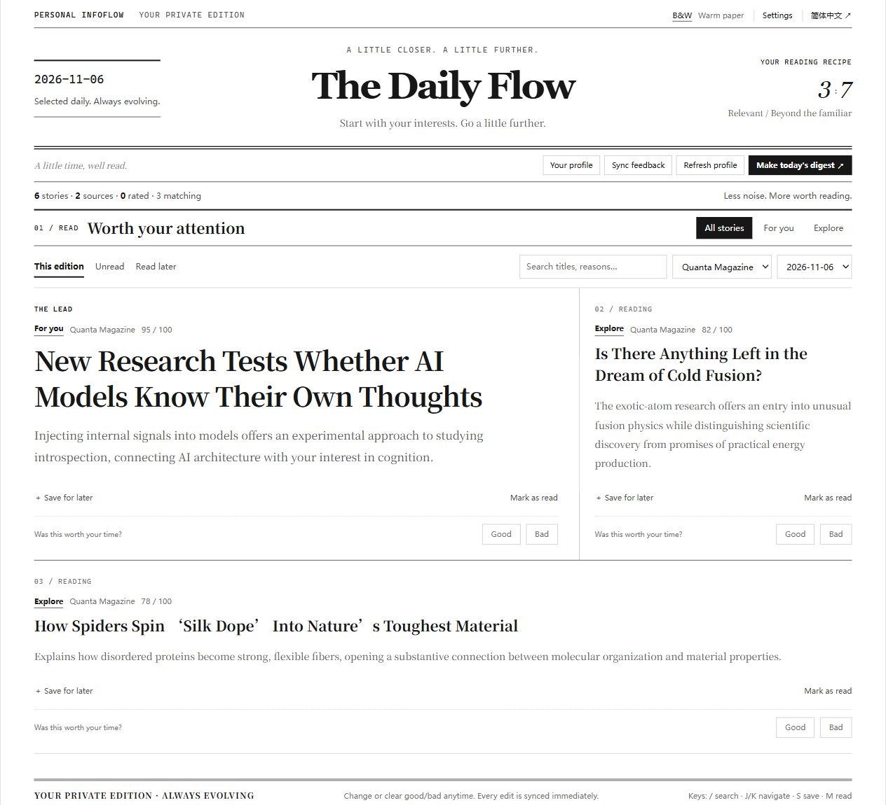

# Personal InfoFlow

**English · [简体中文](README.md)**

Your own daily newspaper, guided by your notes and open to the unexpected.

Personal InfoFlow reads the Obsidian notes you choose, gathers stories from multiple sources, ranks them for relevance and discovery, and writes a daily Markdown digest into your vault. Read in the browser or in Obsidian. Mark a story good or bad to shape the next edition.

Choose your own models, image backend, reading ratio, story count and sources. Switch between English and Chinese, warm paper and black-and-white.



> These are screenshots of the running application, using a public sample interest note, live Hacker News / Quanta Magazine / Ars Technica feeds, and actual ranking through a signed-in Codex CLI. No private notes or fabricated UI data are included. See [verification notes](RELEASE_CHECK.md).

## Features

- **Relevance and discovery**: start with a 30:70 mix, then choose your own exploration share and story count. Feedback-based adaptation is optional.
- **A reader first**: newspaper columns, lead stories, search, source filters, unread stories and a read-later library across editions. Keyboard shortcuts: `/`, `J/K`, `S`, `M`.
- **A lasting archive**: one `YYYY-MM-DD.md` file per day. Another run on the same day appends to it. Earlier editions remain available after restarting or changing providers.
- **Feedback you can undo**: change good to bad, or clear a rating. Web changes synchronize immediately; Markdown edits synchronize on the next run. Old source/keyword bias and preference records are reconciled. Fixes [issue #1](https://github.com/mrk-temple/personal-infoflow/issues/1).
- **Optional signals**: chat exports, manual captures and allowlisted Telegram messages. Saves and visible reading time can contribute weaker positive signals when enabled. No click is treated as a dislike, and opening a link does not mark it read.
- **Layered interests**: long-term knowledge, recent projects and live feedback/captures are handled separately, with configurable time decay. Generated digests are excluded from profile input.


## Get started

Python 3.10 or later is required.

```bash
git clone https://github.com/mrk-temple/personal-infoflow.git
cd personal-infoflow
python3 -m venv .venv
source .venv/bin/activate
python -m pip install -e .
cp config.example.yaml config.yaml
cp .env.example .env
```

On Windows PowerShell, create the environment with `py -3 -m venv .venv`, use `.\.venv\Scripts\python.exe`, and copy the templates with `Copy-Item`.

Set `vault_path` and `digest.output_dir` in `config.yaml`. Relative paths are resolved from the **configuration file's directory**, independent of the current working directory; absolute paths and `~` are also supported.

```bash
python -m infoflow --web
```

Open `http://127.0.0.1:7781`, choose your provider and sources in **Settings**, and make an edition. The example config uses Codex CLI, so no new API key is required for that path. Install and sign in to [Codex CLI](https://learn.chatgpt.com/docs/non-interactive-mode) first, or select your own API provider. Existing account usage limits still apply.

Try the public sample notes without your own vault: `python -m infoflow --config examples/demo-config.yaml --web`. This uses live public feeds and stores private output in ignored `data/demo/`.

## Bring your own models

| Runtime | Configuration |
| --- | --- |
| Codex CLI | Uses the local signed-in CLI. Set its executable path if it is not on PATH. Optionally choose a CLI model; otherwise its own default is used. |
| DeepSeek, Kimi, MiMo, Qwen | Select the provider, model ID and API base URL. Supply your own provider key in Settings or `.env`. Region, workspace and plan-specific endpoints can differ. |
| OpenAI / Anthropic Claude | OpenAI Chat Completions and Anthropic's native Messages API are supported. Enter the model ID you have access to. Product subscriptions and API access have separate setup requirements. |
| OpenAI-compatible service | Use your gateway or compatible local model endpoint, model ID and key. |

Explicit provider selection never borrows another provider's key. The legacy `auto` mode detects existing environment configuration; select a provider explicitly when you have several.

Keys entered in Settings are saved in a local `.env.local` next to your config and are never returned to the browser. Non-secret choices are stored in `data/settings.json` and survive restarts. Both are ignored by Git.

### Optional illustrations

Choose **none**, **your image API**, **Codex CLI**, or a **local Stable Diffusion / Forge** service in Settings.

- Image APIs use an OpenAI-compatible `/images/generations` endpoint, your chosen model and `IMAGE_API_KEY`.
- Codex CLI uses its signed-in image generation capability and `gpt-image-2`, subject to the installed CLI, tool access and account limits.
- Local generation uses `/sdapi/v1/txt2img`, usually at `http://127.0.0.1:7860`. Enable the service's API yourself; optionally name an installed checkpoint.

Generate manually from **Your profile**, or enable automatic generation when refreshing the profile. Portraits are timestamped and archived. If your CLI does not offer built-in image generation, use the app handoff:

```bash
python -m infoflow --portrait-prepare
# Open the resulting prompt.md in Codex App and generate a PNG with $imagegen
python -m infoflow --portrait-import /path/to/generated.png
```

## Daily use

```bash
python -m infoflow
python -m infoflow --refresh-profile
python -m infoflow --feedback          # local reconciliation; no model needed
python -m infoflow --language en
python -m infoflow --capture "Worth saving: https://example.com/article"
python -m infoflow --telegram-sync
```

The language switch changes the interface and the next run's recommendation reasons. Existing stories and archived editions are preserved in their original language.

In Markdown, write `good` or `bad` after `Feedback::`; Chinese editions also accept `好` or `差` after `反馈::`. Remove the mark to withdraw it. Read/unread, read-later and explicit good/bad ratings are independent.

### Telegram captures

Set `TELEGRAM_BOT_TOKEN` in `.env`, add your allowed chat IDs to `telegram.allowed_chat_ids`, then enable `telegram.enabled`. Each run receives at most 100 updates and commits captures with their next offset, so retries do not duplicate messages.

This receiver does not send messages or download attachments. Do not share the same bot's update stream with another poller or an active webhook. More details: [configuration](docs/CONFIGURATION.md).

## Sources and optional embeddings

Built-in adapters cover RSS/Atom, Hacker News, arXiv, Reddit, Google News, GitHub, YouTube and X through your own RSSHub. Add, disable or remove sources in Settings and choose each fetch limit. Unavailable sources are reported and skipped.

```bash
python -m pip install -e ".[embed]"
```

Enable `embedding.enabled` for local semantic deduplication and similarity to liked stories. The first run downloads a model. Without it, title deduplication remains available.

## Upgrade notes

Back up your config, daily archive and state first. Paths now follow the config file. Older releases kept default state in `infoflow/data/`: point the config explicitly to those files, or copy them into `data/` beside the config. Keep the originals until verified.

Run `--refresh-profile` once to replace the older feedback-containing profile cache with the layered format. `--feedback` reconciles existing Markdown, collapses legacy duplicate keys and applies rating edits/clears. History for unavailable/archived dates is retained.

## Development

```bash
python -m pip install -e ".[dev]"
python -m pytest
python -m ruff check .
python tools/check_public.py
```

Protocol tests are not evidence that every provider account has been tested live. See the exact [verification scope](RELEASE_CHECK.md), [architecture](docs/ARCHITECTURE.md), [configuration](docs/CONFIGURATION.md), [design references](docs/DESIGN_NOTES.md), [changelog](CHANGELOG.md), and [security notes](SECURITY.md).

MIT License.
