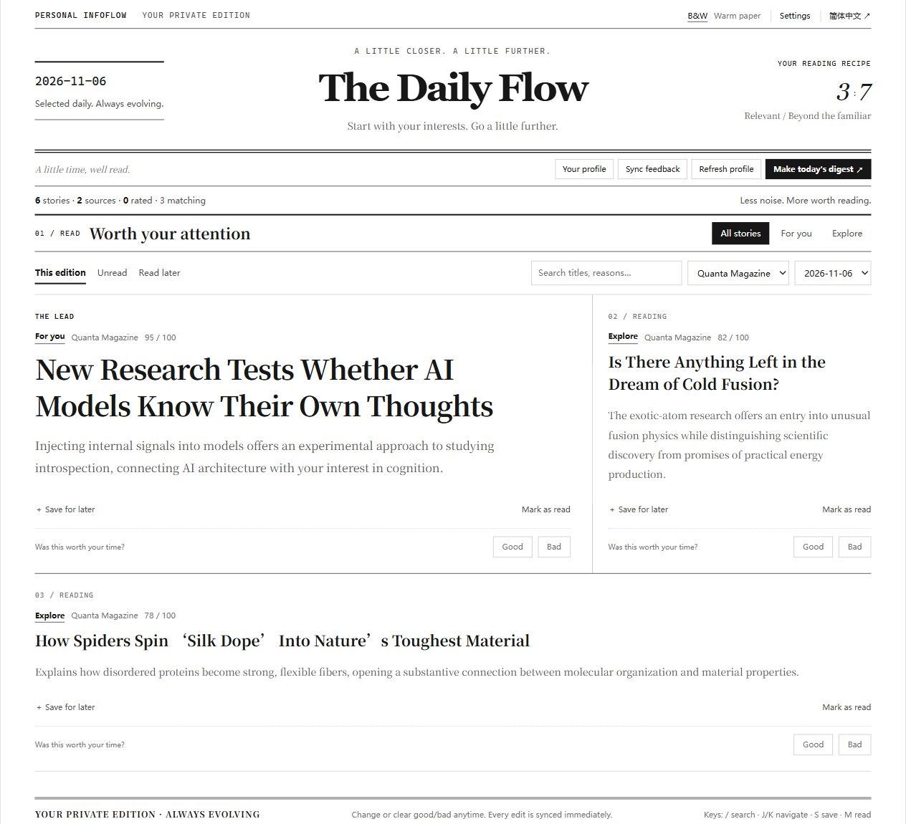
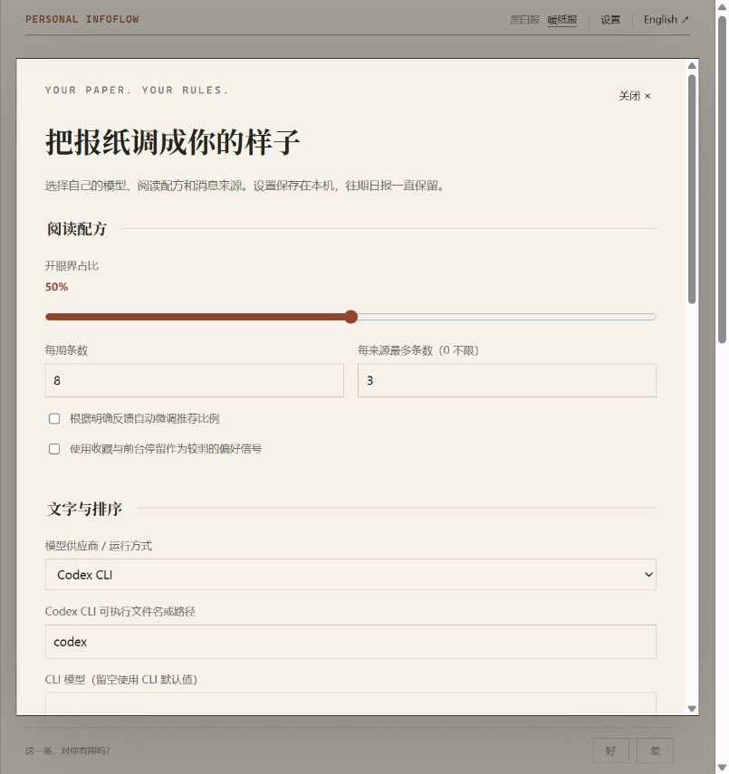
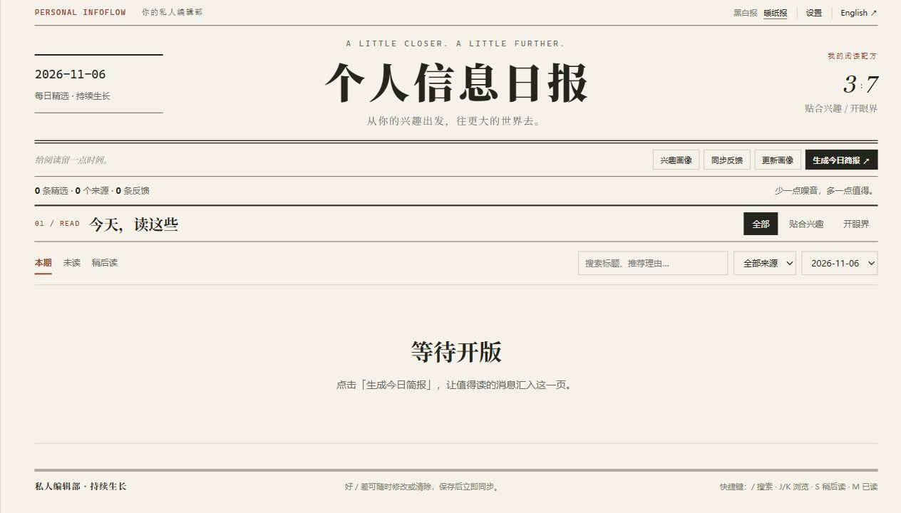
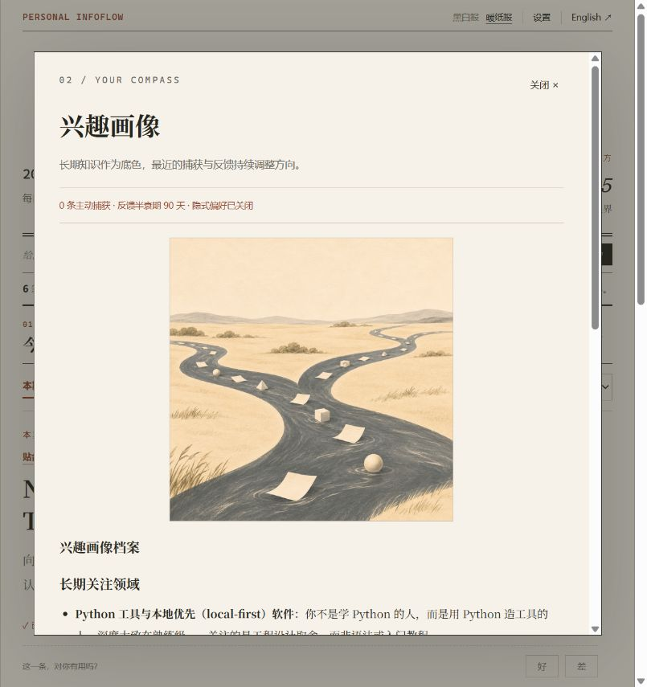

# Personal InfoFlow

**[English](README.en.md) · 简体中文**

一份从你的笔记出发、每天为你选稿的私人报纸。

Personal InfoFlow 读取你指定的 Obsidian 笔记，从公开订阅源采集内容，按兴趣贴合与视野拓展筛选，再把日报写回本地 Markdown。你可以在浏览器里读，也可以直接在 Obsidian 里读；标注“好／差”后，下一期会据此调整。

模型、配图方式、推荐比例、每期条数和订阅源都由你选择。界面支持中英文，以及暖纸报、黑白报两种配色。


> 截图来自本地运行：公开示例兴趣笔记、Hacker News / Quanta Magazine / Ars Technica 的实际采集，以及已登录 Codex CLI 的真实排序。没有使用个人笔记或伪造界面数据。详见[验证记录](RELEASE_CHECK.md)。

## 它能做什么

- **给兴趣留出边界**：默认 3 份贴合、7 份拓展，可在设置里调整到自己的比例，也可启用基于反馈的自适应比例。
- **像读报纸一样阅读**：分栏、头条、来源筛选、搜索、未读、跨日期稍后读；支持 `/` 搜索、`J/K` 浏览、`S` 保存、`M` 标为已读。
- **把每天留下来**：每个日期一篇 `YYYY-MM-DD.md`；同日再运行会追加，重启后可从日期选择器找到往期。改变模型或来源不会删除日报。
- **允许反悔的反馈**：“好”可改成“差”，也可清空；网页立即同步，Obsidian 手改后下次同步。旧标注会从来源、关键词、命中率和偏好记录中撤回。修复详情见 [issue #1](https://github.com/mrk-temple/personal-infoflow/issues/1)。
- **可选的额外信号**：导入 AI 对话、手动捕获、Telegram 白名单接收；收藏和前台可见停留可作为较弱的正向信号，默认关闭，不把未点击当作不喜欢。
- **分层画像**：长期知识、近期项目、实时捕获与明确反馈分开处理；反馈和近期信号有可配置的时间衰减。自动排除日报与画像笔记，避免把自己生成的推荐循环学进去。

## 先看界面

中文暖纸版见上图。英文和黑白配色可以在右上角切换，语言和配色会保存在当前浏览器。



模型与来源收在“设置”里，阅读页不显示供应商名称。



<details>
<summary>第一次打开的样子</summary>



</details>

## 快速开始

需要 Python 3.10+。下面两种安装方式选一种。

**Windows PowerShell**

```powershell
git clone https://github.com/mrk-temple/personal-infoflow.git
cd personal-infoflow
py -3 -m venv .venv
.\.venv\Scripts\python.exe -m pip install -e .
Copy-Item config.example.yaml config.yaml
Copy-Item .env.example .env
```

**macOS / Linux**

```bash
git clone https://github.com/mrk-temple/personal-infoflow.git
cd personal-infoflow
python3 -m venv .venv
source .venv/bin/activate
python -m pip install -e .
cp config.example.yaml config.yaml
cp .env.example .env
```

编辑 `config.yaml` 的 `vault_path` 与 `digest.output_dir`，指向自己的笔记库及日报目录。相对路径以 **config 文件所在目录**为起点；也可用绝对路径或 `~`。

启动阅读页：

```bash
python -m infoflow --web
```

Windows 没有激活虚拟环境时，用 `.\.venv\Scripts\python.exe` 代替 `python`。打开 `http://127.0.0.1:7781`，在“设置”里选择自己的文字模型与消息来源，然后生成日报。

没有准备好自己的 vault 时，可用仓库自带的公开笔记试跑：`python -m infoflow --config examples/demo-config.yaml --web`。它采集真实公开订阅源，日报与状态写到忽略的 `data/demo/`；需要已登录的 Codex CLI。

### 选自己的模型

| 方式 | 配置 |
| --- | --- |
| Codex CLI | 示例配置默认使用此方式。先安装并登录 [Codex CLI](https://learn.chatgpt.com/docs/non-interactive-mode)；可填写可执行文件路径。无需另建 API key，仍会使用账号已有额度。 |
| DeepSeek / Kimi / MiMo / Qwen | 在设置里选择供应商、模型 ID 与服务地址，填写自己的 key；也可使用 `.env`。地区、专属计划或工作空间不同，地址可能不同。 |
| OpenAI / Anthropic Claude | 支持 OpenAI Chat Completions 和 Anthropic 原生 Messages 协议；模型 ID 由你填写。ChatGPT/Claude 的产品订阅与各家 API 配置需分别确认。 |
| 自定义兼容服务 | 填写自己的 OpenAI 兼容地址、模型 ID 和 key，可用于兼容网关或本地模型服务。 |

选择某家供应商后，不会拿另一家的密钥自动顶替。`auto` 保留旧版环境变量检测方式；有多组配置时建议明确选择供应商。

在界面填写的密钥仅写入 config 旁的 `.env.local`，不会返回浏览器。非敏感偏好存到 `data/settings.json`，重启后恢复；`.env.local` 与 `data/` 已忽略。

### 自己决定是否配图

默认不配图。可在设置中选：

1. **自己的生图 API**：填写兼容 `/images/generations` 的服务地址、模型 ID、`IMAGE_API_KEY`。
2. **Codex CLI**：调用已登录的 CLI 与其内置 `gpt-image-2` 能力；受当前 CLI 版本、账号工具权限及额度影响。
3. **本地 Stable Diffusion / Forge**：连接已启用 API 的服务，例如 `http://127.0.0.1:7860` 的 `/sdapi/v1/txt2img`。可填已有 checkpoint；项目不会替你安装模型或启动本地生图服务。

在“兴趣画像”里手动生成，或勾选“更新画像时自动配图”。图片按时间归档，保留旧图。CLI 没有内置生图能力时，可用 App 交接：

<details>
<summary>实测的 CLI 配图与画像窗口</summary>



</details>

```bash
python -m infoflow --portrait-prepare
# 在 Codex App 中打开输出的 prompt.md，用 $imagegen 生成 PNG
python -m infoflow --portrait-import /path/to/generated.png
```

## 日常使用

```bash
python -m infoflow                     # 出一期日报
python -m infoflow --refresh-profile   # 更新长期画像后再出一期
python -m infoflow --feedback          # 只同步反馈，不调用模型
python -m infoflow --language en       # 这次生成英文推荐理由
python -m infoflow --capture "一条值得保存的内容 https://example.com/article"
python -m infoflow --telegram-sync     # 接收一批白名单 Telegram 消息
```

切换界面语言不会改写已有文章或日报。下一次生成的推荐理由使用所选语言；旧日报保持原样。

在 Obsidian 里，可在每条 `反馈::` 后写 `好` / `差`，英文日报则用 `Feedback:: good` / `bad`。删除标记可撤回。网页上的稍后读、已读与明确好坏是独立状态：打开链接不等于已经读完。

### Telegram 捕获

在 `.env` 设置自己的 `TELEGRAM_BOT_TOKEN`，在 config 中填 `telegram.allowed_chat_ids` 白名单，再开启 `telegram.enabled`。每次运行接收最多 100 条更新，继续运行会从已保存的 offset 接着接收；也可以只运行 `--telegram-sync`。

此功能只接收文字、链接与图片说明，不发送消息，不下载附件。不要与同一 bot 的其他轮询器或 webhook 同时占用更新。详见[配置说明](docs/CONFIGURATION.md)。

## 内容源与可选依赖

内置 RSS / Atom、Hacker News、arXiv、Reddit、Google News、GitHub、YouTube，以及指向自建 RSSHub 的 X 适配器。设置里可以添加、关闭或移除来源，并调整每个来源的采集条数。单个源失败会列入运行详情并跳过，其他来源仍可继续。

可选本地语义去重与“更多类似”：

```bash
python -m pip install -e ".[embed]"
```

然后开启 config 中的 `embedding.enabled`。首次使用会下载模型；不安装时会退回标题去重。正文抓取、反馈力度、衰减周期和路径等高级项见 [config.example.yaml](config.example.yaml)。

## 从旧版升级

- 先备份自己的 config、日报和状态；更新源码并重新安装。
- **相对路径现在跟随 config 文件**。旧版默认状态在 `infoflow/data/`；可在 config 中继续显式指向这个目录，或把状态复制到 config 旁的 `data/`。原始文件不用删除。
- 建议升级后执行一次 `--refresh-profile`，让旧版包含反馈的缓存画像更新为分层格式。
- 第一次运行 `--feedback` 会按现有日报重新核对旧反馈，折叠重复键，修正更改与清空的标注。已归档、不在目录中的日期保留历史记录。

## 开发与验证

```bash
python -m pip install -e ".[dev]"
python -m pytest
python -m ruff check .
python tools/check_public.py
```

测试覆盖反馈撤回、真实 HTTP 接口、供应商隔离、CLI 交接、设置持久化、时间衰减与坏模型响应。API 适配器的协议测试不等于所有供应商账号都已实测可用；本轮实测范围与截图来源写在[验证记录](RELEASE_CHECK.md)。

- [架构与 Python 模块](docs/ARCHITECTURE.md)
- [完整配置与隐私边界](docs/CONFIGURATION.md)
- [参考与改进依据](docs/DESIGN_NOTES.md)
- [更新记录](CHANGELOG.md)
- [Agent skill 用法](skill/personal-infoflow/README.md)
- [安全说明](SECURITY.md)

MIT License.
