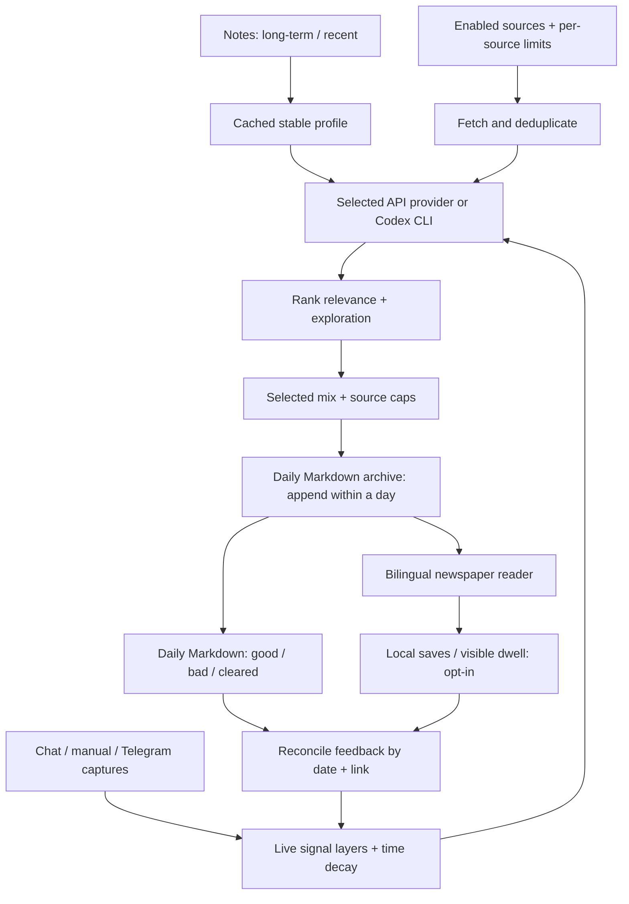

# Architecture / 架构

CLI、Web 和 agent skill 共用 `pipeline.run`，不维护三套推荐逻辑。Web 是标准库 `ThreadingHTTPServer` 加无构建前端；日报 Markdown 是明确反馈的事实来源。

## Python modules

| Module | Responsibility |
| --- | --- |
| `config.py` | YAML loading, defaults, numeric/type validation; paths follow the config file. Loads local preferences and env files. |
| `settings.py` | Whitelisted editable preferences, local persistence, write-only credential input. Never returns key values. Archive paths are not editable through this endpoint. |
| `providers.py` | Provider catalog; native Anthropic Messages and signed-in Codex CLI adapters. Explicit selection isolates each provider's key. |
| `client.py` | Compatible API client, shared text call and JSON extraction. Legacy environment auto-detection remains available. |
| `profile.py` | Excludes generated notes, labels recent/background notes, caches stable knowledge and appends live context on every run. |
| `signals.py` / `capture.py` | Chat exports, capped local captures, allowlisted Telegram polling. Captures and update offset commit together. |
| `activity.py` | Local read/save state and capped visible dwell. Implicit preferences are opt-in, weaker than explicit feedback, and never turn a non-click into a dislike. |
| `items.py` | One Chinese/English Markdown parser used by feedback and the Web reader. |
| `feedback.py` | Reconciles edited, cleared and removed marks; recomputes source/keyword bias, explicit precision and adaptive ratio. |
| `sources.py` / `fetch.py` | Source adapters, UTC dates, bounded RSS requests, per-source diagnostics and failure isolation. |
| `cluster.py` / `semantic.py` | Title/embedding clusters, source provenance and member URLs. Only selected clusters become seen. |
| `embed.py` | Optional fastembed / Ollama vectors and local cache. |
| `enrich.py` / `http.py` | Bounded HTTP, article extraction with the configured timeout, progress reporting. |
| `rank.py` | Provider-independent scoring; validates output instead of silently losing candidates. |
| `digest.py` | Interest/exploration selection, source caps, Chinese/English Markdown, atomic daily append. |
| `portrait.py` | Optional image API, Codex CLI or local SD/Forge. PNG validation, timestamped archives, app handoff. |
| `storage.py` | Atomic same-directory replacement, in-process shared lock, UTC timestamps and half-life weights. Corrupt JSON is reported instead of overwritten. |
| `pipeline.py` / `main.py` | Shared orchestration and local CLI actions. Feedback/capture/import actions do not require a model. |
| `web.py` | Same-origin read/write API, one background run at a time, archive retrieval and scoped image serving. |
| `webapp/` | Packaged HTML/CSS/JS, full UI translations, warm/monochrome themes, reading tools and settings. No CDN or frontend framework. |

## State and persistence

By default, state is under `data/` beside the config, rather than inside an installed Python package:

- `profile.md` and `profile.layers.json`: stable profile and refresh metadata.
- `feedback_log.json`: current explicit verdict indexed logically by `(date, link)`.
- `feedback_state.json`: rebuilt biases, counts and recommendation ratio.
- `activity.json`: local read/save/dwell state; independent of explicit ratings.
- `captures.json`: captured items and the Telegram next-update cursor in one file.
- `settings.json`: non-secret model, image, ratio, source and reading choices.
- `seen.json`: published links and other URLs in their selected duplicate clusters.
- Embedding cache/anchors and optional CLI job output.

Keys entered in the UI go to `.env.local` beside the config. Keys and state are excluded from Git. Daily files stay in `digest.output_dir`, so restarting the server or changing providers leaves history available. The newest existing edition is shown when opening; the date selector also offers today.

## Feedback synchronization

For each readable daily Markdown file, synchronization replaces that date's entries with the marks currently present. A changed mark replaces the old one; a blank or deleted item removes it. Legacy duplicates collapse by date/link. Missing archived editions retain their historical records; unreadable files abort before log/state writes.

Bias uses `2 ** (-age_days / half_life_days)`. Explicit precision counts remain actual rating counts. Implicit saves/dwell use separate lower caps and cannot override an explicit verdict on the same item. Profile live layers are recomputed after feedback synchronization instead of baking temporary feedback into the stable cache.

## Runtime boundaries

The server binds to loopback by default, rejects cross-origin writes and GET requests to mutation endpoints, limits request bodies, escapes story content and permits only HTTP(S) story links. It serves a fixed asset allowlist and a narrowly scoped portrait route. It is a local single-user tool; use one writer per configuration, and keep a backup of the vault/state before upgrades.

Codex text calls use a read-only scoped job directory, `--ephemeral` and a final-response file. Image jobs use a separate writable directory. Both use saved CLI authentication; neither reads/copies OAuth tokens nor forwards API key variables to the CLI.
